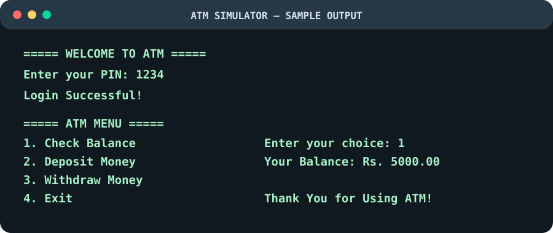
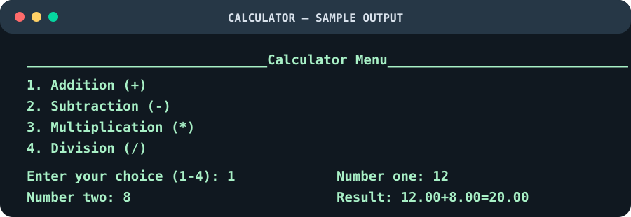
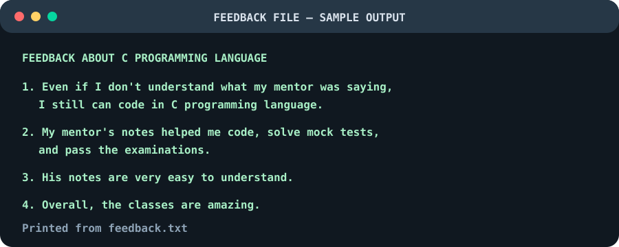
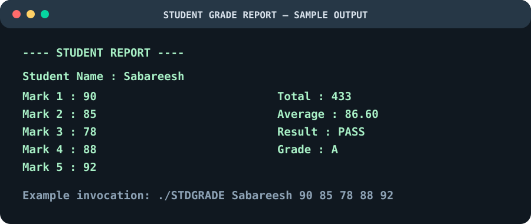

# C Projects

A collection of beginner-friendly C programs demonstrating menu-driven interaction, arithmetic operations, file handling, and command-line arguments.

## Programs

### `atm.c` — ATM simulator
A simple console ATM with PIN login, balance checking, deposits, withdrawals, and an exit option. It starts with a sample balance of Rs. 5,000 and uses PIN `1234`. This is an educational example; it does not connect to a real bank or securely store credentials.



### `CALCI.c` — Calculator
A menu-based calculator for addition, subtraction, multiplication, and division. Division by zero is handled with a message. This source uses `conio.h` functions (`clrscr()` and `getch()`), which are available in some legacy compiler environments but not standard C libraries; a modern compiler may need those calls removed or replaced.



### `FEEDBACK.c` — Feedback file example
Writes a short feedback text to `feedback.txt`, reads the file back, and prints its contents. It also uses legacy `conio.h` functions, so compiler compatibility may require adjustments as described above. The program overwrites `feedback.txt` when it starts.



### `STDGRADE.c` — Student grade report
Accepts a student name and five marks as command-line arguments, then prints the total, average, pass/fail result, and (if passed) a grade. For example:

```sh
./STDGRADE Sabareesh 90 85 78 88 92
```



## Build and run

Use a C compiler such as GCC for programs compatible with your environment. For example:

```sh
gcc atm.c -o atm
./atm
```

`CALCI.c` and `FEEDBACK.c` use legacy `conio.h`; the default GCC toolchain on many modern systems does not provide it. `STDGRADE.c` expects six arguments after the executable: a name followed by five marks.

## Author

The repository commit history identifies **Sabareesh M** as an author. This repository brings together C practice programs covering common introductory programming concepts.
